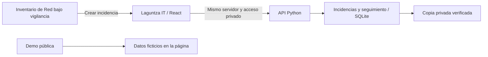

# Laguntza IT

[](https://github.com/liernimurgoitio/laguntza-it/actions/workflows/ci.yml)

Gestión de incidencias de soporte IT con una interfaz React e integración con **Red bajo vigilancia**. He preparado un recorrido desde el aparato observado hasta el seguimiento y la resolución documentada.

## Qué se puede demostrar

- Alta manual desde un aparato del inventario, con nombre y estado observado al crear la incidencia.
- Bandeja con búsqueda, estado, prioridad, paginación y contadores globales.
- Notas de seguimiento, resolución obligatoria y reapertura con motivo.
- Persistencia en SQLite en el servidor privado y rechazo de ediciones simultáneas que utilizan una versión antigua.
- Demo pública con datos ficticios, sin llamadas al servidor doméstico.

[Probar la demo integrada](https://liernimurgoitio.net/demo/soporte/) · [Servidor y documentación de la integración](https://github.com/liernimurgoitio/red-bajo-vigilancia-publico/blob/main/integracion-laguntza.md)

La URL corresponde a la entrega estática de la demo. La publicación en el alojamiento se realiza por separado de un push a GitHub.

## Intercambio ficticio con Zaintza SOC

He añadido **Importar prueba de Zaintza**: lectura local de un JSON de hasta 16 KiB, validación del formato, revisión visible y confirmación antes de preparar el formulario. Leer el archivo no crea una incidencia. El formulario permite editar título, descripción y prioridad; no asocia automáticamente un aparato.

El servidor vuelve a validar el documento y conserva su referencia en SQLite. Reimportar la misma detección abre la incidencia existente sin sobrescribir su seguimiento, incluso después de reiniciar o recuperar una copia. Una referencia con evidencias distintas devuelve un conflicto. El cierre en Laguntza no cambia la investigación de Zaintza.

La primera versión solo admite archivos ficticios v1 y rechaza campos adicionales, datos marcados como reales y versiones desconocidas. La demo ofrece **Descargar ejemplo ficticio** para practicar sin Zaintza instalado. La publicación de esta nueva entrega y su activación privada siguen siendo pasos separados.

## Modos de uso

| Modo | Cómo abrirlo | Dónde guarda los cambios |
| --- | --- | --- |
| Prototipo independiente | Raíz de Vite | Memoria; se pierden al recargar |
| Demo integrada | `?mode=demo-integrada` o `/demo/soporte/` | Memoria; datos ficticios |
| Integración privada | `/soporte/` en Red bajo vigilancia | API Python y SQLite en la Raspberry |

El prototipo independiente no tiene autenticación ni backend. La integración privada reutiliza la contraseña del panel, el control de origen y su token de escritura. Un fallo del servidor real muestra un error; no carga incidencias ficticias como sustitución.

## Desarrollo y comprobaciones

Necesitas Node.js 22.12 o superior.

```bash
cd client
npm ci
npm run dev
```

```bash
npm run lint
npm test
npm run build
```

La compilación se genera en `client/dist` con rutas relativas. Puede servirse en `/soporte/` sin instalar Node.js en la Raspberry. GitHub Actions comprueba el código, las pruebas y la compilación en cada pull request y push a `master`.

## Arquitectura



- `client/src/IncidentDesk.jsx`: flujo de trabajo integrado.
- `client/src/incidentApi.js`: contrato HTTP con el servidor del panel.
- `client/src/demoIncidentApi.js`: adaptador de demo sin acceso de red.
- `client/src/App.jsx`: selección del modo y prototipo original.
- `client/src/IncidentDesk.test.jsx`: pruebas del flujo, errores y contrato.

El backend y sus pruebas se mantienen en Red bajo vigilancia. La guía de integración describe la instalación, los campos, los códigos de error y la recuperación. Esta separación evita duplicar el servidor en dos repositorios.

## Alcance del laboratorio

He comprobado la interfaz con Vitest y Testing Library, y el servidor con pruebas de SQLite y HTTP en Red bajo vigilancia. He conservado el prototipo original y sus pruebas. Las comprobaciones con datos ficticios no acreditan una implantación empresarial.

La versión privada utiliza una identidad compartida y no incorpora roles, SLA, asignación de técnicos ni notificaciones. El registro de seguimiento es persistente, pero no es una auditoría inviolable. No se generan incidencias por cada desconexión. El intercambio de detecciones reales de Zaintza SOC sigue pendiente; esta entrega solo incorpora un recorrido con datos ficticios.

## Autoría

Proyecto de Lierni Murgoitio. React 19, Vite 7, Vitest, Testing Library y ESLint.
